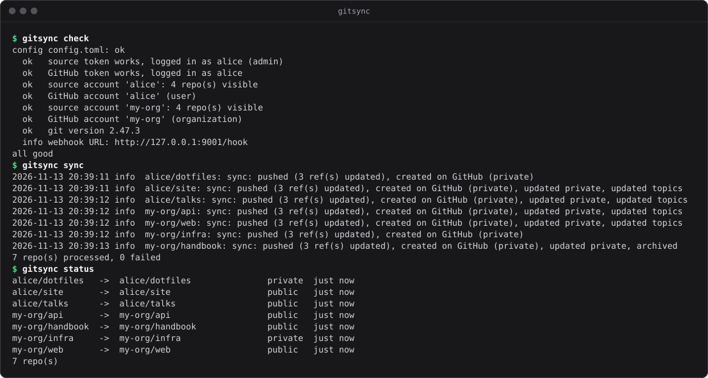
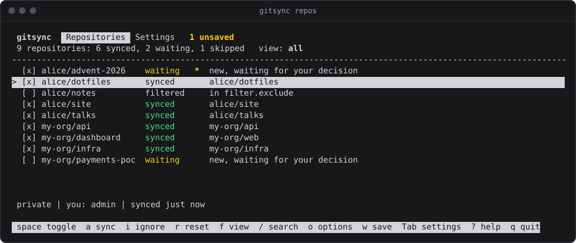
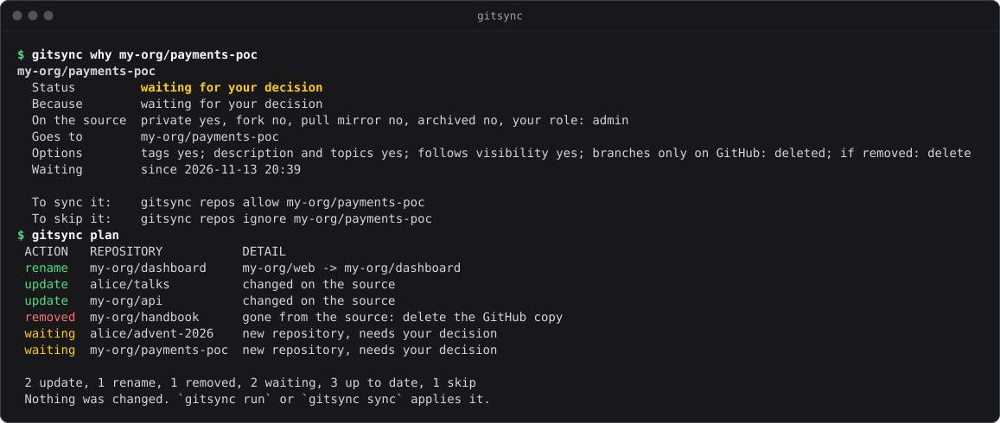
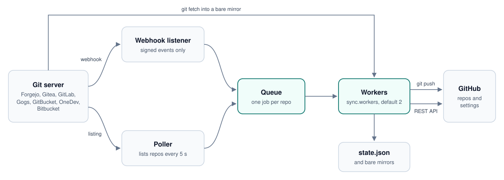

<div align="center">


# gitsync

**Replica tu servidor git propio en GitHub y lo mantiene al día.**

Un push llega a GitHub en pocos segundos. Crear, renombrar, archivar o borrar un repositorio, o cambiar su visibilidad, descripción o temas, se sigue igual de rápido. Un binario pequeño, sin cron y sin runtime.

[](https://github.com/cristobaltormo/git-sync/actions/workflows/ci.yml)
[](https://github.com/cristobaltormo/git-sync/releases)
[](LICENSE)
[](https://www.rust-lang.org)

[Inicio rápido](#inicio-rápido) · [Documentación](#documentación) · [FAQ](docs/faq.md) · [Changelog](CHANGELOG.md) · [English](README.md)

<br>



</div>

<br>

## Por qué

Si tu código vive en Forgejo, Gitea, GitLab u otro servidor que montas tú, GitHub sigue siendo donde la gente lo busca. Mantener allí una copia a mano, o con un script que sube todo cada hora, funciona hasta que un repositorio se renombra, se hace privado o se borra. gitsync toma el servidor git como la fuente de la verdad y mantiene GitHub igual que él, repositorio a repositorio, a medida que cambian las cosas.

- **Rápido, gracias a los webhooks.** Un push, una rama nueva o un tag nuevo están en GitHub en 2 a 5 segundos. Un sondeo cada 5 segundos recoge lo que el servidor no anuncia y cualquier webhook que se pierda. Mira [qué es inmediato y qué no](#qué-es-inmediato-y-qué-no).
- **El repositorio entero, no solo los commits.** Los repositorios nuevos se crean en GitHub, los renombres se aplican sobre el mismo repositorio para que las estrellas y los enlaces sigan funcionando, y la visibilidad, la descripción, la web, los temas, la rama por defecto y el estado de archivado siguen a la fuente.
- **Cuidadoso al borrar.** Un repositorio que desaparece solo se toca pasados `delete_grace` segundos y después de preguntar por él directamente al servidor, como mucho `delete_limit` por hora, y nunca en una cuenta distinta de la configurada. Puedes archivar en lugar de borrar, o no hacer nada.
- **Tú decides qué se publica.** Filtros por dueño, patrón, tema, fork o rol; un selector en la terminal; y un modo de revisión en el que los repositorios nuevos esperan tu decisión en lugar de publicarse. Un repositorio privado nunca se hace público.
- **Ligero.** Unos 4,3 MiB de memoria residente y 15 ms de CPU por minuto sondeando 30 repositorios en tres cuentas, con un binario estático de 3,2 MiB. Mira las [mediciones](docs/benchmarks.md).
- **Los tokens no se ven.** Se pasan a git por su entorno, nunca en una URL, una línea de comandos o un `.git/config`, cada uno limitado a su propio host, y se eliminan de cada línea del log.
- **Funciona en cualquier sitio.** Linux (amd64, arm64, armv7), macOS, Windows y Docker. Se instala solo como servicio de systemd o como tarea programada de Windows, y sus tests pasan en los tres sistemas en cada push.

## Servidores compatibles

| Servidor | Estado | Webhooks |
|---|---|---|
| Forgejo, Codeberg | probado | un webhook de sistema (token de admin) o uno por repo |
| Gitea | probado | uno por repo (un webhook de sistema necesita reiniciar Gitea, mira la guía) |
| GitLab, propio y gitlab.com | probado | un webhook de sistema (token de admin) o uno por repo |
| Gogs | probado | uno por repo |
| GitBucket | probado | uno por repo |
| OneDev | probado | uno por repo |
| Bitbucket Cloud | probado | uno por repo, Bitbucket tiene que llegar a tu servidor (mira la guía) |
| Bitbucket Server y Data Center | experimental | uno por repo |

Probado quiere decir que cada paso de la sincronización se ha ejecutado contra un servidor real: Forgejo 16, Gitea 1.27, GitLab 19, Gogs 0.14, GitBucket 4.48, OneDev 16 y Bitbucket Cloud. Bitbucket Server y Data Center se escribieron a partir de su documentación y solo se han probado contra un servidor simulado, porque ejecutarlos requiere licencia. Qué puede y qué no puede hacer cada servidor, y cómo dejar pasar sus webhooks, está en [docs/providers.md](docs/providers.md).

## Qué es inmediato y qué no

Los servidores git mandan un webhook cuando alguien hace push o crea o borra una rama o un tag. La mayoría no manda nada cuando un repositorio se renombra, se hace público o privado, se archiva, cambia de descripción o se borra. gitsync escucha los webhooks y además sondea.

| Cambio en el servidor git | Se detecta por | En GitHub tras |
|---|---|---|
| push, rama nueva o borrada, tag nuevo | webhook | 2 a 5 segundos |
| repo nuevo | webhook o sondeo | 3 a 5 segundos |
| visibilidad, descripción, web, temas, rama por defecto, archivado, renombre | sondeo, o webhook donde el servidor lo manda | hasta 5 segundos, más lo que tarde en aplicarse |
| repo borrado | sondeo, y luego una confirmación | unos 15 segundos |

El sondeo lista tus repositorios cada 5 segundos, unos 3 KB por repositorio, y compara los campos que se replican con el listado anterior. Solo se sincroniza el repositorio que ha cambiado. `poll_interval` se puede subir, o poner a 0 para depender solo de los webhooks. Las latencias medidas en cada servidor están en [docs/benchmarks.md](docs/benchmarks.md).

## Inicio rápido

Necesitas `git` 2.32 o posterior en la máquina donde corre gitsync ([Git for Windows](https://gitforwindows.org) en Windows), un token de acceso del servidor git y un token de GitHub (mira [Tokens](#tokens)).

### 1. Instalar

Cada [release](https://github.com/cristobaltormo/git-sync/releases) trae un binario por plataforma y un fichero `SHA256SUMS` para comprobarlos.

| Plataforma | Fichero |
|---|---|
| Linux x86-64 | `gitsync-linux-amd64` |
| Linux ARM64 (Raspberry Pi 3 o posterior con un sistema de 64 bits) | `gitsync-linux-arm64` |
| Linux ARMv7 | `gitsync-linux-armv7` |
| macOS, Apple silicon | `gitsync-darwin-arm64` |
| macOS, Intel | `gitsync-darwin-amd64` |
| Windows x64 | `gitsync-windows-amd64.exe` |
| Windows ARM64 | `gitsync-windows-arm64.exe` |

Linux, con el fichero de tu máquina:

```sh
f=gitsync-linux-amd64
curl -fLO https://github.com/cristobaltormo/git-sync/releases/latest/download/$f
curl -fLO https://github.com/cristobaltormo/git-sync/releases/latest/download/SHA256SUMS
grep " $f\$" SHA256SUMS | sha256sum -c
mv $f gitsync && chmod +x gitsync
```

En macOS es igual con `f=gitsync-darwin-arm64` (o `-amd64`) y `shasum -a 256 -c` en lugar de `sha256sum -c`.

Windows, en PowerShell:

```powershell
$base = "https://github.com/cristobaltormo/git-sync/releases/latest/download"
Invoke-WebRequest "$base/gitsync-windows-amd64.exe" -OutFile gitsync.exe
Invoke-WebRequest "$base/SHA256SUMS" -OutFile SHA256SUMS
(Get-FileHash gitsync.exe -Algorithm SHA256).Hash.ToLower()
Select-String "gitsync-windows-amd64.exe" SHA256SUMS
```

Los dos hashes que salen al final tienen que coincidir.

Docker: cada release publica una imagen multiarquitectura (`linux/amd64`, `linux/arm64`) en el [GitHub Container Registry](https://github.com/cristobaltormo/git-sync/pkgs/container/git-sync). Mira [Docker](#docker) más abajo.

Desde el código, con una [toolchain de Rust](https://rustup.rs) estable y actual:

```sh
cargo install --locked --git https://github.com/cristobaltormo/git-sync gitsync
```

La compilación incluye un juego de certificados raíz como reserva para sistemas que no tienen ninguno. Los paquetes de distribución que usan el almacén del sistema pueden quitarlo con `cargo build --release --no-default-features`.

### 2. Configurar y comprobar

```sh
./gitsync init      # hace unas preguntas y escribe config.toml
./gitsync check     # prueba los dos tokens, sus permisos y cada cuenta
./gitsync run --dry-run
```

`init` inicia sesión en los dos lados sobre la marcha y genera el secreto del webhook. `run --dry-run` registra lo que haría sin cambiar nada en ningún lado. Todas las opciones están descritas en [docs/configuration.md](docs/configuration.md).

### 3. Dejarlo funcionando

En Linux con systemd:

```sh
sudo ./gitsync install
```

Esto crea un usuario de sistema `gitsync`, copia el binario a `/usr/local/bin` y la configuración (y `repos.toml`, si hay uno al lado) a `/etc/gitsync`, y arranca un servicio de systemd con un tope de memoria de 512 MB. Los logs están en `journalctl -u gitsync -f`. Después de editar la configuración, `systemctl reload gitsync` la aplica sin reiniciar, aunque el daemon también detecta un fichero cambiado por sí solo en el siguiente sondeo.

En Windows, ejecuta `gitsync install` desde un PowerShell abierto como administrador. Copia el binario a `C:\Program Files\gitsync` y la configuración a `C:\ProgramData\gitsync`, accesible solo para administradores, y registra una tarea programada que arranca con Windows, se ejecuta como SYSTEM y se vuelve a lanzar en menos de un minuto si se para. Si el webhook no escucha en localhost, también abre ese puerto en el firewall de Windows. El log es `C:\ProgramData\gitsync\gitsync.log` y los mirrors están en `C:\ProgramData\gitsync\state`. En Windows no hay `kill -HUP`: después de editar la configuración vuelve a ejecutar `gitsync install`, o `schtasks /End /TN gitsync` y deja que la tarea lo arranque. `gitsync uninstall` quita la tarea, la regla del firewall y el binario.

En macOS no hay instalador: mantén `gitsync run` vivo con launchd, o usa Docker.

### Tokens

En el servidor git, crea un token de acceso que pueda leer los repositorios y gestionar sus webhooks. Si es de un administrador, gitsync crea un único webhook de sistema que cubre todos los repositorios, también los que se creen después, en los servidores que lo permiten. Si no, crea un webhook por repositorio. Los permisos de cada servidor están en [docs/providers.md](docs/providers.md).

En GitHub, un token personal clásico con los permisos `repo` y `delete_repo`. Puedes quitar `delete_repo` si pones `on_delete` a `"archive"` o `"ignore"`. También vale un token fine-grained con permiso de escritura en Administration y Contents sobre los repositorios.

### Si los webhooks no llegan

La mayoría de servidores se niegan a llamar a direcciones de redes privadas o de la propia máquina salvo que lo permitas. El ajuste de cada servidor está en [docs/providers.md](docs/providers.md), y [docs/troubleshooting.md](docs/troubleshooting.md) explica cómo ver si un webhook llega a gitsync. Si prefieres no tocar la configuración del servidor git, pon `hooks.mode = "none"`: todo sigue funcionando con el sondeo, solo que un push tarda de 4 a 8 segundos en lugar de 2 a 5.

### Docker

```sh
docker run -d --name gitsync --restart unless-stopped \
  -v ./config.toml:/config/config.toml:ro -v gitsync-data:/data \
  ghcr.io/cristobaltormo/git-sync:latest
```

Fija una versión con un tag, por ejemplo `ghcr.io/cristobaltormo/git-sync:v2.0.0`, o construye la imagen tú mismo desde un clon con `docker build -t gitsync .`. En un contenedor pon `listen.host = "0.0.0.0"` y en `listen.public_url` la dirección con la que el servidor git llega a él, por ejemplo `http://gitsync:9001/hook` si los dos están en la misma red de Docker. [`compose.yaml`](compose.yaml) sirve de punto de partida. Si el servidor git está en otra máquina, publica el puerto (`-p 9001:9001`) y usa la dirección de esa máquina en `public_url`. Los tokens pueden venir del entorno en lugar del fichero: `GITSYNC_SOURCE_TOKEN`, `GITSYNC_GITHUB_TOKEN` y `GITSYNC_WEBHOOK_SECRET`.

## Elegir qué se sincroniza

Por defecto gitsync replica todos los repositorios de las cuentas que configuras. Cuando eso es demasiado hay tres capas: reglas generales en `[filter]`, un sí o un no para repositorios concretos en `repos.toml`, y opciones por repositorio, como otro nombre en GitHub.

```sh
gitsync repos
```

abre un selector en la terminal: cada repositorio con su casilla, búsqueda, una vista de los que esperan tu decisión y opciones por repositorio. Espacio cambia uno, `w` guarda, y un gitsync en marcha lo aplica por sí solo. Lo mismo se puede hacer desde scripts con `gitsync repos allow`, `ignore`, `set` y `list --json`.

<p align="center">
  
</p>

Si otras personas pueden añadirte a sus proyectos, pon `new_repos = "review"`: los repositorios que gitsync no ha visto nunca esperan tu decisión en lugar de publicarse, y lo que ya se sincroniza sigue sincronizándose. `gitsync init` ofrece perfiles ya hechos (`personal`, `team`, `careful`) y `gitsync config profile` aplica uno más tarde. `gitsync why <repo>` explica la decisión sobre un repositorio, y `gitsync plan` enseña lo que haría la próxima sincronización sin hacerlo:

<p align="center">
  
</p>

Todo está explicado en [docs/choosing-repos.md](docs/choosing-repos.md).

## Comparado con otras opciones

| | gitsync | Push mirror de Forgejo y Gitea | Un script con cron |
|---|---|---|---|
| Configuración | una vez, para todos los repositorios de las cuentas configuradas, también los nuevos | una vez por repositorio, a mano | una vez |
| Push en GitHub tras | 2 a 5 s con webhook, hasta 5 s más sin él | unos 4 s con "sync on commit", si no su intervalo | la siguiente ejecución |
| Crea el repositorio en GitHub | sí, privado hasta subir el contenido | no, tiene que existir | si el script lo hace |
| Visibilidad, descripción, temas, rama por defecto, archivado | se siguen | no se siguen | si el script lo hace |
| Renombres y borrados | renombre sobre el mismo repo; borrados confirmados, limitados y opcionalmente archivados | no se siguen | si el script lo hace |
| Servidores de origen | Forgejo, Gitea, GitLab, Gogs, GitBucket, OneDev, Bitbucket | solo el suyo | cualquiera |
| Elegir repositorios | filtros, tema, selector, revisión de los nuevos | uno a uno | en el script |
| Se ejecuta como | un daemon aparte, unos 4,3 MiB de memoria | parte del servidor git, nada más | cron, una shell y git |

El push mirror integrado es la opción más sencilla para unos pocos repositorios que ya existen en GitHub cuando solo importa el código: no hay nada que ejecutar. Los datos del push mirror salen de las mediciones de [docs/benchmarks.md](docs/benchmarks.md), que comparan gitsync con el push mirror de Gitea y con el script al que gitsync sustituyó.

## Cómo funciona

<picture>
  <source media="(prefers-color-scheme: dark)" srcset="docs/images/architecture-dark.svg">
  
</picture>

Un solo proceso con tres partes: un receptor de webhooks, un sondeo y unos pocos workers, que comparten una cola con un trabajo por repositorio. Un trabajo trae de la fuente a un mirror local, sube ramas y tags a GitHub con `--prune` y aplica los ajustes con la API de GitHub, cerrando la visibilidad antes de un push y abriéndola solo después. Dos trabajos del mismo repositorio nunca se solapan, los que fallan se reintentan con esperas crecientes, y un comando git que se queda 15 segundos sin dar señales se corta y se vuelve a lanzar. Todo lo que gitsync sabe está en un `state.json`; los mirrors son una caché. El detalle está en [docs/architecture.md](docs/architecture.md).

## Conviene saber

La copia en GitHub es exacta. Las ramas y los tags se suben forzados y con prune, así que GitHub siempre es igual que la fuente y lo que se haga directamente en la copia de GitHub se sobrescribe. Solo se replican los datos de git, más la descripción, la web, los temas, la rama por defecto, la visibilidad y el estado de archivado, donde el servidor los da. Las pull requests, issues, wikis, releases y objetos LFS no se replican.

Los repositorios nuevos se crean privados en GitHub, se suben, y solo entonces se abren si la fuente es pública. Un repositorio privado en la fuente nunca se hace público.

Un repositorio que ya existe en GitHub y que no creó gitsync se deja en paz y se avisa en el log. Pon `adopt_existing = true` para que gitsync se haga cargo de él, sabiendo que la copia de GitHub se sobrescribirá para igualarla a la fuente. Una vez adoptado se trata igual que uno creado por gitsync: un renombre en la fuente lo renombra, y un borrado en la fuente puede acabar borrándolo, con las salvaguardas de arriba. Adopta solo un repositorio que estés dispuesto a ceder.

GitHub aplica los cambios de visibilidad despacio. Hacer público un repositorio y volverlo privado en pocos segundos da "a previous visibility change is still in progress" y pushes rechazados durante un rato; gitsync lo reconoce, espera diez segundos y lo reintenta. GitHub también rechaza pushes que contienen un token que reconoce: el error queda en el log y el repositorio se reintenta con esperas crecientes hasta que el secreto desaparece del historial.

## Comandos

| | |
|---|---|
| `gitsync init` | escribe un fichero de configuración haciendo preguntas |
| `gitsync check` | valida la configuración, los tokens, los permisos y las cuentas |
| `gitsync run [--dry-run]` | el daemon |
| `gitsync sync [dueño/nombre ...]` | replica una vez y termina, todo o solo algunos repositorios |
| `gitsync status` | cada repositorio, adónde va, cuándo se sincronizó y el último error |
| `gitsync repos` | elegir qué se sincroniza: selector, `list`, `allow`, `ignore`, `reset`, `set` |
| `gitsync why <repo>` | por qué un repositorio se sincroniza o no, y cómo cambiarlo |
| `gitsync plan [--json]` | qué haría la próxima sincronización, sin cambiar nada |
| `gitsync report` | pull requests en los mirrors y repositorios que solo existen en GitHub |
| `gitsync config` | `show`, `get`, `set`, `edit`, `path`, `profile`, `test-notify` |
| `gitsync hooks [--force] [--remove]` | crea, reescribe o quita los webhooks |
| `gitsync install` / `uninstall` | servicio de systemd en Linux, tarea programada en Windows |
| `gitsync version` | muestra la versión |

`-c fichero.toml` elige otra configuración. Sin él se prueban `$GITSYNC_CONFIG`, `./config.toml` y después `/etc/gitsync/config.toml`. El daemon recarga la configuración y `repos.toml` cuando cambian; `kill -HUP` lo fuerza.

## Documentación

La documentación detallada está en inglés.

| | |
|---|---|
| [Configuración](docs/configuration.md) | cada clave de `config.toml` y `repos.toml`, con su tipo y su valor por defecto |
| [Servidores](docs/providers.md) | tokens, dueños y ajustes de webhooks de cada servidor git |
| [Elegir qué se sincroniza](docs/choosing-repos.md) | reglas, decisiones, perfiles, revisión, pull requests, notificaciones |
| [Cómo funciona](docs/architecture.md) | hilos, el sondeo, una sincronización paso a paso, fallos, borrados, credenciales |
| [Mediciones](docs/benchmarks.md) | latencia por servidor y cambio, memoria y CPU, 2.0 frente a 1.3 |
| [Problemas frecuentes](docs/troubleshooting.md) y [FAQ](docs/faq.md) | cuando algo no funciona, y preguntas habituales |
| [Changelog](CHANGELOG.md) | qué cambió en cada versión |

## Preguntas frecuentes

**¿Replica issues, pull requests o releases?** No. Solo ramas, tags y los ajustes del repositorio de la lista de arriba. Mira [qué se copia](docs/faq.md#what-exactly-is-copied-to-github).

**¿Puede sincronizar en los dos sentidos?** No. El servidor git es la fuente de la verdad y GitHub es una copia; a una pull request abierta en un mirror se le puede contestar con un comentario, pero nunca se fusiona allí. Mira [pull requests en los mirrors](docs/faq.md#people-open-pull-requests-on-the-mirror-what-happens).

**¿Qué pasa si mi token pierde acceso?** Un token que ya no ve un repositorio es indistinguible de un repositorio borrado, y por eso los borrados esperan `delete_grace`, se confirman preguntando directamente al servidor y están limitados por hora. Una cuenta que de repente no lista nada se trata como acceso perdido, no como un borrado masivo.

**¿Puedo usarlo sin webhooks?** Sí, con `hooks.mode = "none"`. El sondeo lo detecta todo; un push solo tarda unos segundos más.

Más en [docs/faq.md](docs/faq.md).

## Actualizar desde 1.x

La versión 2.0 es una reescritura en Rust con los mismos comandos, flags, claves de configuración, valores por defecto, endpoint del webhook y líneas de log. Lee y escribe `config.toml`, `repos.toml` y `state.json` con el mismo formato, así que actualizar consiste en cambiar el binario:

```sh
sudo systemctl stop gitsync
sudo install -m 755 gitsync /usr/local/bin/gitsync
sudo systemctl start gitsync
```

Volver a ejecutar `sudo ./gitsync install` hace lo mismo y además renueva la unidad; un `repos.toml` distinto que ya exista en `/etc/gitsync` se conserva. Volver a 1.3.0 es el mismo cambio, porque 1.3.0 lee lo que escribe 2.0. Si alguna vez se ejecutó un comando de 1.x como root en una instalación con servicio, revisa antes el dueño del directorio de estado: mira [problemas frecuentes](docs/troubleshooting.md#the-service-cannot-read-statejson). La lista completa de cambios está en [CHANGELOG.md](CHANGELOG.md).

## Desarrollo

```sh
make test      # cargo fmt --check, cargo clippy y cargo test
make build     # compilación release, copiada a ./gitsync
make release   # binarios para cada plataforma y sumas de comprobación en dist/
```

`make release` compila los binarios de Linux con [cargo-zigbuild](https://github.com/rust-cross/cargo-zigbuild) y necesita una máquina macOS y otra Windows para el resto; el workflow de release compila cada uno en su propio runner. `make platform PLATFORM=linux-arm64` compila uno solo. Los tests usan servidores falsos en 127.0.0.1 y no necesitan red.

Los informes de fallos con la salida de `gitsync check` y un log con `log.level = "debug"` (los tokens salen ocultos) son la contribución más útil. Las preguntas e ideas van a [Discussions](https://github.com/cristobaltormo/git-sync/discussions). Mira [CONTRIBUTING.md](CONTRIBUTING.md) para pull requests y para añadir un servidor git, el [código de conducta](CODE_OF_CONDUCT.md), y la [política de seguridad](SECURITY.md) para informar de una vulnerabilidad.

## Créditos

La idea de este proyecto, y su primera versión, son de
[Mario Gómez](https://github.com/mariogdn), que escribió un script inicial que
subía repositorios a GitHub cada hora. gitsync se desarrolló a partir de ahí por
Cristóbal Tormo.

## Licencia

Apache License 2.0, mira [LICENSE](LICENSE) y [NOTICE](NOTICE).
