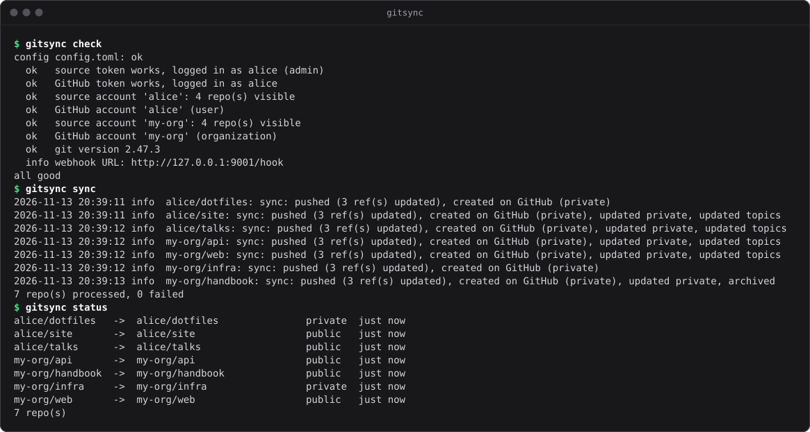
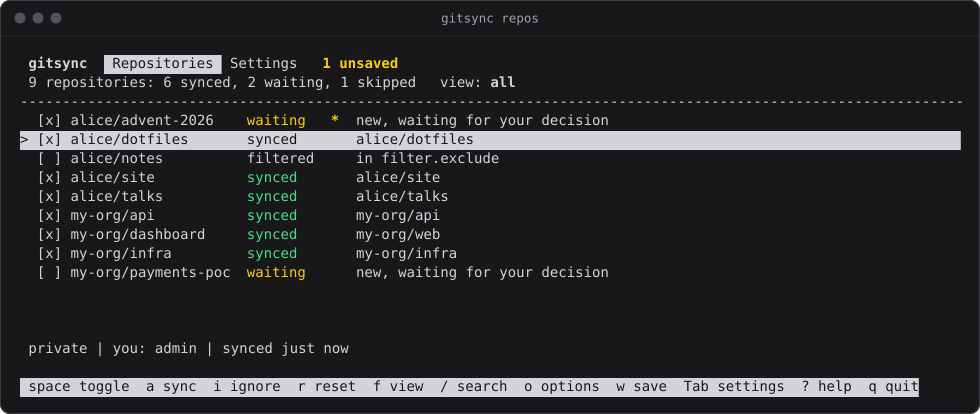
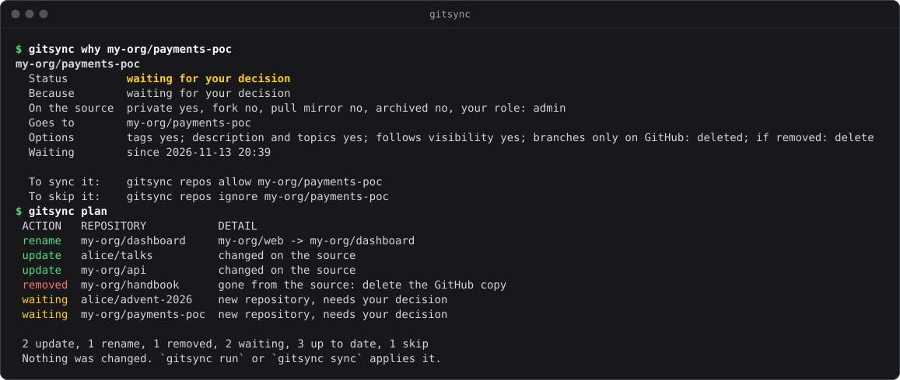
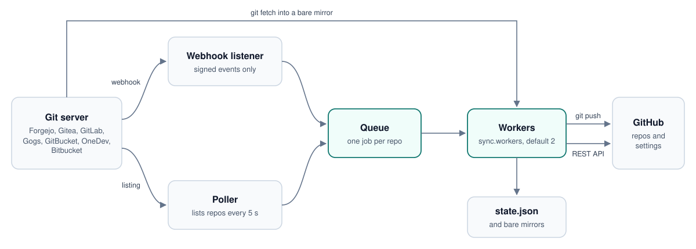

<div align="center">


# gitsync

**Mirror your self-hosted git server to GitHub, and keep it in step.**

A push reaches GitHub in a few seconds. Creating, renaming, archiving or deleting a repository, or changing its visibility, description or topics, follows just as fast. One small binary, no cron, no runtime.

[](https://github.com/cristobaltormo/git-sync/actions/workflows/ci.yml)
[](https://github.com/cristobaltormo/git-sync/releases)
[](LICENSE)
[](https://www.rust-lang.org)

[Quick start](#quick-start) · [Documentation](#documentation) · [FAQ](docs/faq.md) · [Changelog](CHANGELOG.md) · [Español](README.es.md)

<br>



</div>

<br>

## Why

If your code lives on Forgejo, Gitea, GitLab or another server you run yourself, GitHub is still where people look for it. Keeping a copy there by hand, or with a script that pushes every hour, works until a repository is renamed, made private or deleted. gitsync treats the git server as the source of truth and keeps GitHub equal to it, repository by repository, as things change.

- **Fast, through webhooks.** A push, a new branch or a new tag is on GitHub in 2 to 5 seconds. A poll every 5 seconds catches what the server does not announce and any webhook that gets lost. See [what is instant and what is not](#what-is-instant-and-what-is-not).
- **The whole repository, not only the commits.** New repositories are created on GitHub, renames are applied in place so stars and links survive, and visibility, description, website, topics, default branch and the archived flag follow the source.
- **Careful with deletions.** A repository that disappears is only acted on after `delete_grace` seconds and after asking the server for it directly, at most `delete_limit` per hour, and never on an account other than the one mapped. You can archive instead of deleting, or do nothing.
- **You choose what goes public.** Filters by owner, pattern, topic, fork or role; a selector in the terminal; and a review mode where new repositories wait for your decision instead of being published. A private repository never becomes public.
- **Light.** Measured on 2.0, about 4.3 MiB of resident memory and 15 ms of CPU per minute while polling 30 repositories in three accounts. The static release binary is about 3.2 MiB. See the [benchmarks](docs/benchmarks.md).
- **Tokens stay out of sight.** They are passed to git through its environment, never in a URL, a command line or a `.git/config`, each scoped to its own host, and removed from every log line.
- **Runs anywhere.** Linux (amd64, arm64, armv7), macOS, Windows and Docker. It installs itself as a systemd service or a Windows scheduled task, and its tests run on the three systems on every push.

## Supported servers

| Server | Status | Webhooks |
|---|---|---|
| Forgejo, Codeberg | tested | one system webhook (admin token) or per repo |
| Gitea | tested | per repo (a system webhook needs a Gitea restart, see the guide) |
| GitLab, self-hosted and gitlab.com | tested | one system webhook (admin token) or per repo |
| Gogs | tested | per repo |
| GitBucket | tested | per repo |
| OneDev | tested | per repo |
| Bitbucket Cloud | tested | per repo, Bitbucket has to reach your server (see the guide) |
| Bitbucket Server and Data Center | experimental | per repo |

Tested means every step of the sync was run against a real server: Forgejo 16, Gitea 1.27, GitLab 19, Gogs 0.14, GitBucket 4.48, OneDev 16 and Bitbucket Cloud. Bitbucket Server and Data Center were written from their documentation and have only been exercised against a simulated server, since running them needs a licence. What each server can and cannot do, and how to let its webhooks through, is in [docs/providers.md](docs/providers.md).

## What is instant and what is not

Git servers send a webhook when someone pushes or creates or deletes a branch or tag. Most of them send nothing when a repository is renamed, made public or private, archived, retitled or deleted. gitsync listens for webhooks and also polls.

| Change on the git server | Noticed through | On GitHub after |
|---|---|---|
| push, new or deleted branch, new tag | webhook | 2 to 5 seconds |
| new repo | webhook or poll | a few seconds, up to about 8 on Bitbucket Cloud |
| visibility, description, website, topics, default branch, archived, rename | poll, or webhook where the server sends one | up to 5 seconds, plus the time to apply it |
| repo deleted | poll, then a confirmation | about 12 seconds |

The poll lists your repositories every 5 seconds and compares the fields that get mirrored with the previous listing. Only a repository that changed is synced. `poll_interval` can be raised, or set to 0 to rely on webhooks alone. Measured latencies for each server are in [docs/benchmarks.md](docs/benchmarks.md).

## Quick start

You need `git` 2.32 or newer on the machine that runs gitsync ([Git for Windows](https://gitforwindows.org) on Windows), an access token for the git server and a GitHub token (see [Tokens](#tokens)).

### 1. Install

Every [release](https://github.com/cristobaltormo/git-sync/releases) has a binary for each platform and a `SHA256SUMS` file to check them against.

| Platform | File |
|---|---|
| Linux x86-64 | `gitsync-linux-amd64` |
| Linux ARM64 (Raspberry Pi 3 and later with a 64-bit system) | `gitsync-linux-arm64` |
| Linux ARMv7 | `gitsync-linux-armv7` |
| macOS, Apple silicon | `gitsync-darwin-arm64` |
| macOS, Intel | `gitsync-darwin-amd64` |
| Windows x64 | `gitsync-windows-amd64.exe` |
| Windows ARM64 | `gitsync-windows-arm64.exe` |

Linux, with the file for your machine:

```sh
f=gitsync-linux-amd64
curl -fLO https://github.com/cristobaltormo/git-sync/releases/latest/download/$f
curl -fLO https://github.com/cristobaltormo/git-sync/releases/latest/download/SHA256SUMS
grep " $f\$" SHA256SUMS | sha256sum -c
mv $f gitsync && chmod +x gitsync
```

macOS is the same with `f=gitsync-darwin-arm64` (or `-amd64`) and `shasum -a 256 -c` in place of `sha256sum -c`.

Windows, in PowerShell:

```powershell
$base = "https://github.com/cristobaltormo/git-sync/releases/latest/download"
Invoke-WebRequest "$base/gitsync-windows-amd64.exe" -OutFile gitsync.exe
Invoke-WebRequest "$base/SHA256SUMS" -OutFile SHA256SUMS
(Get-FileHash gitsync.exe -Algorithm SHA256).Hash.ToLower()
Select-String "gitsync-windows-amd64.exe" SHA256SUMS
```

The two hashes printed at the end must be the same.

Docker: each release publishes a multi-arch image (`linux/amd64`, `linux/arm64`) to the [GitHub Container Registry](https://github.com/cristobaltormo/git-sync/pkgs/container/git-sync). See [Docker](#docker) below.

From source, with a current stable [Rust toolchain](https://rustup.rs):

```sh
cargo install --locked --git https://github.com/cristobaltormo/git-sync gitsync
```

The build bundles a set of root certificates as a fallback for systems without any. Distribution packages that rely on the system store can leave it out with `cargo build --release --no-default-features`.

### 2. Configure and check

```sh
./gitsync init      # asks a few questions and writes config.toml
./gitsync check     # tests both tokens, their permissions and every account
./gitsync run --dry-run
```

`init` logs in to both sides as it goes and generates the webhook secret. `run --dry-run` logs what it would do and changes nothing on either side. Every option is described in [docs/configuration.md](docs/configuration.md).

### 3. Keep it running

On Linux with systemd:

```sh
sudo ./gitsync install
```

This creates a `gitsync` system user, copies the binary to `/usr/local/bin` and the config (and `repos.toml`, if there is one next to it) to `/etc/gitsync`, and starts a systemd service with a 512 MB memory cap. Logs are in `journalctl -u gitsync -f`. After editing the config, `systemctl reload gitsync` applies it without a restart, although the daemon also notices a changed file by itself on the next poll.

On Windows, run `gitsync install` from a PowerShell opened as administrator. It copies the binary to `C:\Program Files\gitsync` and the config to `C:\ProgramData\gitsync`, restricted to administrators, and registers a scheduled task that starts with Windows, runs as SYSTEM and is started again within a minute if it ever stops. If the webhook listener is not on localhost it also opens that port in the Windows firewall. The log is `C:\ProgramData\gitsync\gitsync.log` and the mirrors are in `C:\ProgramData\gitsync\state`. There is no `kill -HUP` on Windows: after editing the config run `gitsync install` again, or `schtasks /End /TN gitsync` and let the task start it. `gitsync uninstall` removes the task, the firewall rule and the binary.

On macOS there is no installer: keep `gitsync run` alive with launchd, or use Docker.

### Tokens

On the git server, create an access token that can read the repositories and manage their webhooks. If it belongs to an admin, gitsync creates one system-wide webhook that covers every repository, including the ones created later, on the servers that have them. Otherwise it creates one webhook per repository. The scopes for each server are in [docs/providers.md](docs/providers.md).

On GitHub, a classic personal access token with the scopes `repo` and `delete_repo`. Leave out `delete_repo` if you set `on_delete` to `"archive"` or `"ignore"`. A fine-grained token works too if it has Administration and Contents write access to the repositories.

### If webhooks never arrive

Most servers refuse to call addresses on private networks or on the machine itself unless you allow it. The setting for each server is in [docs/providers.md](docs/providers.md), and [docs/troubleshooting.md](docs/troubleshooting.md) shows how to see whether a webhook reaches gitsync. If you would rather not touch the git server's config, set `hooks.mode = "none"`: everything keeps working through the poll, only a push takes 4 to 8 seconds instead of 2 to 5.

### Docker

```sh
docker run -d --name gitsync --restart unless-stopped \
  -v ./config.toml:/config/config.toml:ro -v gitsync-data:/data \
  ghcr.io/cristobaltormo/git-sync:latest
```

Pin a version with a tag, for example `ghcr.io/cristobaltormo/git-sync:v2.0.0`, or build the image yourself from a clone with `docker build -t gitsync .`. In a container set `listen.host = "0.0.0.0"` and `listen.public_url` to the address the git server uses to reach it, for example `http://gitsync:9001/hook` when both are on the same Docker network. [`compose.yaml`](compose.yaml) is a starting point. When the git server is on another machine, publish the port (`-p 9001:9001`) and use that machine's address in `public_url`. Tokens can come from the environment instead of the file: `GITSYNC_SOURCE_TOKEN`, `GITSYNC_GITHUB_TOKEN` and `GITSYNC_WEBHOOK_SECRET`.

## Choosing what to sync

By default gitsync mirrors every repository of the accounts you map. When that is too much, there are three layers: general rules in `[filter]`, a yes or no for single repositories in `repos.toml`, and per-repository options such as a different name on GitHub.

```sh
gitsync repos
```

opens a selector in the terminal: every repository with a checkbox, search, a view of the ones waiting for you, and per-repository options. Space switches one, `w` writes, and a running gitsync applies it by itself. The same can be done from scripts with `gitsync repos allow`, `ignore`, `set` and `list --json`.

<p align="center">
  
</p>

If other people can add you to their projects, set `new_repos = "review"`: repositories gitsync has never seen wait for your decision instead of being published, and anything already syncing keeps syncing. `gitsync init` offers ready-made profiles (`personal`, `team`, `careful`) and `gitsync config profile` applies one later. `gitsync why <repo>` explains the decision for one repository, and `gitsync plan` shows what the next sync would do without doing it:

<p align="center">
  
</p>

Everything is described in [docs/choosing-repos.md](docs/choosing-repos.md).

## How it compares

| | gitsync | Push mirror built into Forgejo and Gitea | A cron script |
|---|---|---|---|
| Set up | once, for every repository of the mapped accounts, including new ones | once per repository, by hand | once |
| Push on GitHub after | 2 to 5 s through a webhook, up to 5 s more without | about 4 s with "sync on commit", otherwise its interval | the next run |
| Creates the GitHub repository | yes, private until the content is pushed | no, it has to exist | if the script does it |
| Visibility, description, topics, default branch, archived | followed | not followed | if the script does it |
| Renames and deletions | renamed in place; deletions confirmed, rate limited, optionally archived | not followed | if the script does it |
| Source servers | Forgejo, Gitea, GitLab, Gogs, GitBucket, OneDev, Bitbucket | its own server only | any |
| Choosing repositories | filters, topic, selector, review of new ones | per repository | in the script |
| Runs as | a separate daemon, about 4.3 MiB of memory | part of the git server, nothing extra | cron, a shell and git |

The built-in push mirror is the simpler choice for a handful of repositories that already exist on GitHub when only the code matters: there is nothing to run. The push mirror figures come from the measurements in [docs/benchmarks.md](docs/benchmarks.md), which compare gitsync with Gitea's push mirror and with the script gitsync replaced.

## How it works

<picture>
  <source media="(prefers-color-scheme: dark)" srcset="docs/images/architecture-dark.svg">
  
</picture>

One process with three parts: a webhook listener, a poller and a small pool of workers, sharing a queue with one job per repository. A job fetches from the source into a bare mirror, pushes branches and tags to GitHub with `--prune`, and applies the settings through the GitHub API, closing visibility before a push and opening it only after. Jobs for the same repository never overlap, failed ones are retried with growing delays, and a git command that stalls for 15 seconds is stopped and run again. Everything gitsync knows is in one `state.json`; the mirrors are a cache. The details are in [docs/architecture.md](docs/architecture.md).

## Things worth knowing

The GitHub copy is exact. Branches and tags are force-pushed and pruned, so GitHub always equals the source and whatever is done directly on the GitHub copy gets overwritten. Only git data is mirrored, plus description, website, topics, default branch, visibility and the archived flag, where the server provides them. Pull requests, issues, wikis, releases and LFS objects are not mirrored.

New repositories are created private on GitHub, pushed, and only then opened up if the source is public. A repository that is private on the source never becomes public.

A repository that already exists on GitHub and was not created by gitsync is left alone and reported in the log. Set `adopt_existing = true` to let gitsync take it over, knowing the GitHub copy will be overwritten to match the source. Once adopted it is treated exactly like one gitsync created: a rename at the source renames it, and a deletion at the source can eventually delete it, subject to the safeguards above. Only adopt a repository you are fine handing over.

GitHub applies visibility changes slowly. Making a repository public and private again within seconds gets "a previous visibility change is still in progress" and rejected pushes for a while; gitsync recognises that, waits ten seconds and tries again. GitHub also rejects pushes that contain a token it recognises: the error is in the log and the repository is retried with growing delays until the secret is gone from the history.

## Commands

| | |
|---|---|
| `gitsync init` | write a config file, asking questions |
| `gitsync check` | validate the config, tokens, scopes and accounts |
| `gitsync run [--dry-run]` | the daemon |
| `gitsync sync [owner/name ...]` | mirror once and exit, everything or just some repositories |
| `gitsync status` | each repository, where it goes, when it last synced, last error |
| `gitsync repos` | choose what is synced: selector, `list`, `allow`, `ignore`, `reset`, `set` |
| `gitsync why <repo>` | why a repository is or is not synced, and how to change it |
| `gitsync plan [--json]` | what the next sync would do, changing nothing |
| `gitsync report` | pull requests on mirrors, repositories that exist only on GitHub |
| `gitsync config` | `show`, `get`, `set`, `edit`, `path`, `profile`, `test-notify` |
| `gitsync hooks [--force] [--remove]` | create, rewrite or remove the webhooks |
| `gitsync install` / `uninstall` | systemd service on Linux, scheduled task on Windows |
| `gitsync version` | print the version |

`-c file.toml` picks another config. Without it, `$GITSYNC_CONFIG`, `./config.toml` and then `/etc/gitsync/config.toml` are tried. The daemon reloads the config and `repos.toml` when they change; `kill -HUP` forces it.

## Documentation

| | |
|---|---|
| [Configuration](docs/configuration.md) | every key of `config.toml` and `repos.toml`, with its type and default |
| [Servers](docs/providers.md) | tokens, owners and webhook settings for each git server |
| [Choosing what to sync](docs/choosing-repos.md) | rules, decisions, profiles, review, pull requests, notifications |
| [How it works](docs/architecture.md) | threads, the poll, one sync step by step, failures, deletions, credentials |
| [Benchmarks](docs/benchmarks.md) | latency per server and change, memory and CPU, 2.0 against 1.3 |
| [Troubleshooting](docs/troubleshooting.md) and [FAQ](docs/faq.md) | when something does not work, and common questions |
| [Changelog](CHANGELOG.md) | what changed in each release |

## FAQ

**Does it mirror issues, pull requests or releases?** No. Only branches, tags and the repository settings listed above. See [what is mirrored](docs/faq.md#what-exactly-is-copied-to-github).

**Can it sync in both directions?** No. The git server is the source of truth and GitHub is a copy; a pull request opened on a mirror can be answered with a comment, but it is never merged there. See [pull requests on mirrors](docs/faq.md#people-open-pull-requests-on-the-mirror-what-happens).

**What happens if my token loses access?** A token that can no longer see a repository looks exactly like a deleted repository, which is why removals wait for `delete_grace`, are confirmed by asking the server directly, and are limited per hour. An account that suddenly lists nothing is treated as lost access, not as a mass deletion.

**Can I run it without webhooks?** Yes, with `hooks.mode = "none"`. The poll notices everything; a push just takes a few seconds longer.

More in [docs/faq.md](docs/faq.md).

## Upgrading from 1.x

Version 2.0 is a rewrite in Rust with the same commands, flags, configuration keys, defaults, webhook endpoint and exit codes. Most log lines are unchanged; the few messages that changed are listed in [CHANGELOG.md](CHANGELOG.md). It reads and writes `config.toml`, `repos.toml` and `state.json` in the same format, so upgrading is a matter of replacing the binary:

```sh
sudo systemctl stop gitsync
sudo install -m 755 gitsync /usr/local/bin/gitsync
sudo systemctl start gitsync
```

Running `sudo ./gitsync install` again does the same and also refreshes the unit; an existing, different `repos.toml` in `/etc/gitsync` is kept. Going back to 1.3.0 is the same swap, since 1.3.0 reads what 2.0 writes. If a 1.x command was ever run as root on a service install, check the owner of the state directory first: see [troubleshooting](docs/troubleshooting.md#the-service-cannot-read-statejson). The full list of changes is in [CHANGELOG.md](CHANGELOG.md).

## Development

```sh
make test      # cargo fmt --check, cargo clippy and cargo test
make build     # release build, copied to ./gitsync
make release   # binaries for every platform and checksums in dist/
```

`make release` cross-compiles the Linux binaries with [cargo-zigbuild](https://github.com/rust-cross/cargo-zigbuild) and needs a macOS and a Windows machine for the others; the release workflow builds each one on its own runner. `make platform PLATFORM=linux-arm64` builds a single one. The tests use fake servers on 127.0.0.1 and need no network.

Bug reports with the output of `gitsync check` and a log with `log.level = "debug"` (tokens are hidden) are the most useful contribution. Questions and ideas go to [Discussions](https://github.com/cristobaltormo/git-sync/discussions). See [CONTRIBUTING.md](CONTRIBUTING.md) for pull requests and for adding a git server, the [code of conduct](CODE_OF_CONDUCT.md), and the [security policy](SECURITY.md) to report a vulnerability.

## Credits

The idea for this project, and its first version, came from
[Mario Gómez](https://github.com/mariogdn), who wrote an initial script that
pushed repositories to GitHub every hour. gitsync was developed from there by
Cristóbal Tormo.

## License

Apache License 2.0, see [LICENSE](LICENSE) and [NOTICE](NOTICE).
