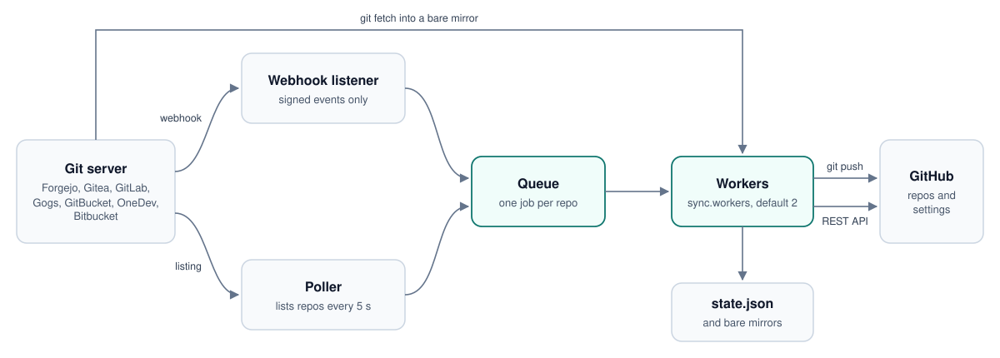

# How it works

gitsync is one process with three moving parts: a webhook listener, a poller and a
small pool of workers. They share a queue of repos to sync, and everything it
knows is kept in one JSON state file.

<picture>
  <source media="(prefers-color-scheme: dark)" srcset="images/architecture-dark.svg">
  
</picture>

## Modules

gitsync is written in Rust as one crate: a library with the whole program and a
thin binary on top of it.

| Module | Role |
|---|---|
| `src/main.rs` | entry point |
| `src/cli` | the commands (run, sync, check, status, repos, why, plan, report, config, hooks, init, install), flag parsing, signals and the selector |
| `src/config` | `config.toml` and `repos.toml`: defaults, validation, secrets from files and environment, edits that keep comments and file ownership |
| `src/forge` | one provider per git server behind the `Provider` trait: `gitea.rs` (Forgejo, Codeberg, Gitea, Gogs), `gitlab.rs`, `gitbucket.rs`, `onedev.rs`, `bitbucket.rs`; `mod.rs` holds the listing page cache |
| `src/github.rs` | the GitHub API client |
| `src/mirror` | the git commands that copy branches and tags, and how a stalled one is stopped on Unix and on Windows |
| `src/engine` | state, queue, poll, the decision of what to do for each repo, renames, removals, webhook setup, notifications, pull requests |
| `src/webhook.rs` | the HTTP listener, which hands events to the engine |
| `src/httpx.rs` | HTTP client with retries, rate limit handling, redirects, proxies and TLS roots |
| `src/logx.rs` | logging that never prints a secret |
| `src/error.rs` | the error type; configuration errors end with exit code 2 |
| `src/version.rs` | the version string, set at build time |

## Threads

There is no async runtime. The daemon runs a few plain threads with small stacks,
each blocked on a condition variable or a read until there is work:

- the main thread, which waits for signals and reloads the config on `SIGHUP`;
- the webhook listener, plus one short-lived thread per connection, capped at 256
  at a time, with limits on header size, body size and time;
- the poller;
- `sync.workers` workers that take jobs from the queue;
- a short-lived thread for each notification, only when `[notify]` is set.

Each git command gets a watchdog and readers for its output. HTTP goes through one
shared [ureq](https://github.com/algesten/ureq) agent with connection reuse and
[rustls](https://github.com/rustls/rustls), so the binary needs no OpenSSL. It
trusts the system certificates and falls back to a bundled set when there are none,
as in a `scratch` container.

A panic while syncing one repo is caught and recorded as that repo's error, the
same as any other failure. The worker carries on with the next job.

## The poll

Every `poll_interval` seconds the engine lists the repos of each configured owner
and hashes the fields it mirrors, plus the update time where the server has one.
If the hash equals the previous one, nothing happened and nothing else is done.
If it differs, every listed repo is compared with what was stored last time and
only those that changed are queued. Listing pages are hashed as raw bytes first, so
an unchanged page is not even decoded.

The comparison is on fields rather than on the update time because servers
disagree on what bumps it: Forgejo updates it on every edit, Gitea only for
pushes and topics.

## Syncing one repo

A job for one repo does, in this order:

1. Work out the GitHub name and owner. If the repo was renamed at the source,
   rename the GitHub repo; if the new name is taken, stop with an error.
2. Find the GitHub repo. If it does not exist, create it private. If it exists
   and gitsync did not create it, stop unless `adopt_existing` is set.
3. Before pushing: unarchive if needed, and make GitHub private if the source
   became private. Visibility is only ever closed before a push.
4. `git fetch` from the source into a bare mirror, then `git push --prune` to
   GitHub. Only branches and tags are transferred, always forced, so the two
   sides end up identical.
5. After pushing: open visibility if the source is public, copy description,
   website, topics and default branch, archive if the source is archived.
6. Record the result, including a snapshot of the GitHub repo, so the next push
   needs no GitHub API calls unless something changed.

Jobs for the same repo never run at the same time. Events that arrive while one
is running are merged into a single follow-up, and webhooks wait 100 ms so the
push and create events of one `git push` become one job.

## Failures

A failed job is retried with growing delays (30 seconds up to 30 minutes). GitHub
answers a few things in a way that means "try again in a moment", such as a
visibility change still in progress, and those are retried within seconds. A repo
that gitsync refuses to touch, for example because the name is taken on GitHub, is
looked at again every ten minutes but only logged once.

A git command that writes nothing at all for 15 seconds is a stalled connection, since even
a very large transfer keeps reporting progress. gitsync kills the whole process group and
tries again straight away, up to three times. Without it a stuck TLS handshake to GitHub
holds a sync for about a minute and a half before git gives up by itself.

## Deletions

A repo that vanishes from a listing is not deleted on the spot. It has to stay
missing for `delete_grace` seconds, the server has to answer that the repo does
not exist when asked for it directly, and its owner has to still exist, because a
token that lost access looks exactly like a deletion. Then `on_delete` decides.
There is also a limit of `delete_limit` deletions per hour, and nothing is
deleted on GitHub that is owned by an account other than the one mapped.

## Credentials

Tokens never appear in a URL, a command line or a `.git/config`. git receives
them as `http.<url>.extraheader` values in its environment, scoped to the server
they belong to, so the source token is never sent to GitHub or the other way
round. Logs pass through a filter that replaces every known secret.

## State

`state.json` maps each source repo id to what gitsync last did with it: the GitHub
name, the last snapshot of the GitHub repo, the last error and when to retry. The
ids survive renames and transfers. The bare mirrors under `repos/` are a cache and
can be deleted at any time.
